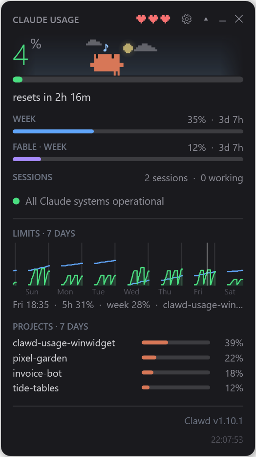
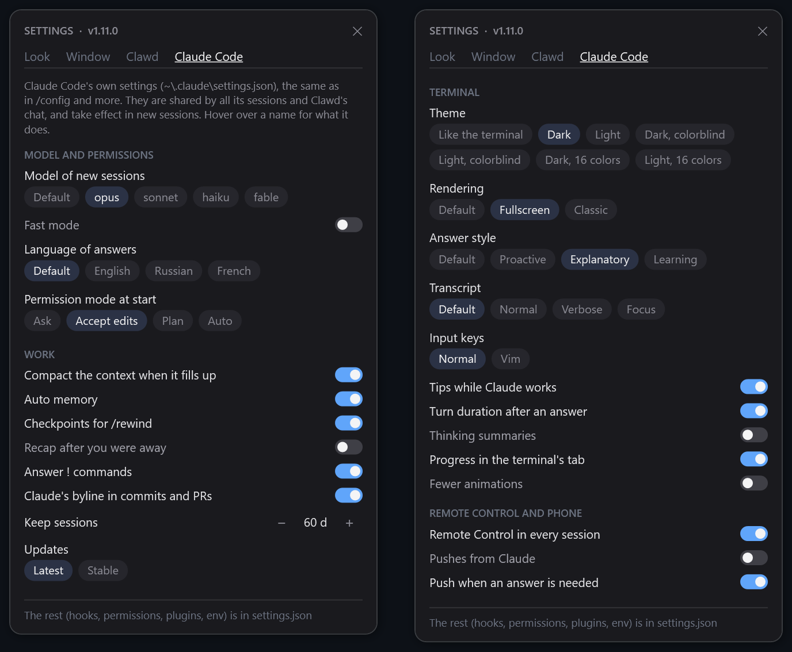
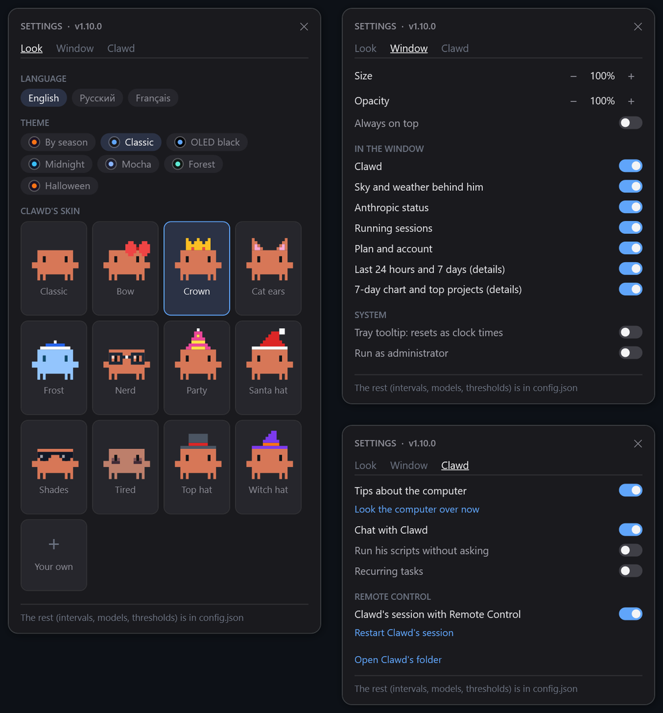

# clawd-usage-winwidget

Una pequeña ventana flotante + icono en la bandeja para Windows que muestra cuánto
llevas gastado de los límites de tu plan de Claude: los mismos números que `/usage`
en Claude Code, actualizados cada minuto. Y un Clawd pixelado que vive dentro y
reacciona a lo que hacen tus sesiones.


[English](README.md) · [Русский](README.ru.md) · **Español**

El idioma de la interfaz es el inglés por defecto; el español se activa en los
ajustes (el engranaje de la cabecera de la ventana → Look → Español) o con la clave
`"language": "es"` en `config.json`.

- **Solo números oficiales.** Los porcentajes salen de `claude -p "/usage"`: el
  comando se ejecuta sin interfaz, habla con Anthropic con tu sesión ya iniciada y
  **no llama al modelo ni gasta tokens**.
- **Sin dependencias.** Windows PowerShell 5.1 + WPF, que vienen con Windows. Sin
  Node, sin npm, sin instalador. Solo necesitas el propio Claude Code.
- **Clawd.** El cangrejo de la pantalla de bienvenida de Claude Code, hecho con los
  mismos caracteres de bloque y con las mismas animaciones. Duerme cuando no hay
  nada en marcha, corretea cuando una sesión trabaja, saluda cuando una sesión te
  espera, suda cerca del límite y se queda panza arriba cuando se agota.

<table><tr>
<td></td>
<td></td>
</tr></table>

## Instalación

Requisitos: Windows 10/11 y [Claude Code](https://docs.claude.com/en/docs/claude-code)
instalado y con la sesión iniciada (`claude` en el `PATH`).

```powershell
git clone https://github.com/Enhed/clawd-usage-winwidget.git
```

o descarga el ZIP y descomprímelo donde quieras. Después haz doble clic en
`start-widget.vbs` (arranca el widget en silencio, sin ventana de consola).

Arranque con Windows: ejecuta una vez en PowerShell desde la carpeta del widget:

```powershell
$a = New-ScheduledTaskAction -Execute "wscript.exe" -Argument "`"$PWD\start-widget.vbs`""
$t = New-ScheduledTaskTrigger -AtLogOn
Register-ScheduledTask -TaskName "clawd usage widget" -Action $a -Trigger $t -RunLevel Limited
```

Solo se ejecuta una copia a la vez, así que arrancarlo a mano además del inicio
automático no hace daño.

Windows esconde los iconos nuevos de la bandeja en el desbordamiento (`^`). Para que
se vea siempre: Configuración → Personalización → Barra de tareas → Otros iconos de
la bandeja del sistema → `clawd-usage-winwidget`.

## Qué muestra

- **Número grande**: la sesión actual (la ventana de 5 horas), directamente del
  servidor. Con **Semana como límite principal** (Ajustes → Ventana, `mainLimit`),
  el número grande, el icono y la salud de Clawd siguen el límite semanal; la
  sesión de 5 horas aparece en la línea pequeña. La barra pasa de verde → amarillo (60%) → rojo (85%).
- **se reinicia en 3h 03m**: el tiempo hasta que se reinicia la ventana, a partir
  de la hora exacta de reinicio que da `/usage`.
- **SEMANA**: el límite semanal y el tiempo hasta su reinicio. **FABLE · SEMANA**:
  el límite semanal aparte de Fable; se oculta si `/usage` no lo indica.
- **SESIONES**: cuántas sesiones de Claude Code están en marcha, cuántas trabajan y
  cuántas te esperan. Pasa el ratón para ver la lista: `▶` trabajando, `?`
  esperando (permiso, pregunta, diálogo; qué exactamente va entre paréntesis), `○`
  inactiva, más la carpeta. Útil para pillar un agente olvidado que se come tu
  límite sin hacer ruido.

  Las sesiones de otra máquina (un servidor en casa, una VM) se pueden añadir con
  `remoteSessions` en `config.json`: una lista de URLs o rutas de archivo, cada una
  de las cuales devuelve las sesiones activas de esa máquina con la forma de
  `~/.claude/sessions/<pid>.json`:

  ```json
  { "generatedAt": "2026-10-17T03:41:47+00:00", "host": "unraid",
    "sessions": [ { "name": "api", "status": "busy", "waitingFor": "",
                    "kind": "interactive", "sessionId": "4b8ca9ab-..." } ] }
  ```

  El que las publica solo lista sesiones activas; `cwd` es opcional. Cuentan para
  la línea y para Clawd, y muestran el `host` en la lista. Una fuente que falla, se
  cuelga o tiene un `generatedAt` de hace más de dos minutos no añade nada.
- **Estado del servicio**: verde "Todos los sistemas de Claude funcionan", o
  amarillo/rojo con la incidencia activa y los componentes afectados. Un clic abre
  status.claude.com.
- **Icono de la bandeja**: el mismo porcentaje como número de color; la info
  emergente añade la semana y Fable.
- Línea inferior: tu plan y el correo de la cuenta ("sin sesión iniciada" en rojo
  si la autenticación caducó) y la hora de la última respuesta de `/usage`, marcada
  como "desactualizado" si es antigua.

El ▾ de la cabecera despliega los detalles (se recuerda entre arranques):

- **ÚLTIMAS 24 HORAS / ÚLTIMOS 7 DÍAS**: peticiones, sesiones y el desglose "What's
  contributing to your limits usage?" de `/usage`: la parte con contexto grande, el
  contexto fijo, las sesiones con muchos subagentes, los servidores MCP, skills y
  subagentes principales. El propio Claude Code lo considera aproximado y solo
  cuenta este equipo.
- **LÍMITES · 7 DÍAS** (desactivado por defecto, `showHistory`): los porcentajes de
  5 horas (verde) y semanal (azul) de la última semana, una línea cada uno. Pasa el
  ratón para ver el momento bajo el cursor: la hora, ambos porcentajes y el proyecto
  que más gastó en esa hora. En el primer arranque el gráfico se rellena con las
  transcripciones que dejaron en `~/.claude/projects` las comprobaciones de `/usage`
  de versiones anteriores; a partir de ahí cada respuesta de `/usage` es una muestra
  en `usage-history.json`.
- **PROYECTOS · 7 DÍAS**: los proyectos que más gastaron esta semana, según la
  carpeta en la que se ejecutaron. Se calcula con las transcripciones de Claude Code
  de este equipo: tokens ponderados por el precio del modelo, así que los
  porcentajes son una estimación de lo que se fue en los límites, no una cifra
  oficial.
- **Versión**: tu versión de Claude Code. Si hay una más nueva, la línea se pone
  amarilla: pasa el ratón para ver el CHANGELOG oficial entre tu versión y la
  última, y haz clic para ejecutar `claude update` en una ventana aparte; si no, un
  clic abre el registro de cambios de Claude Code. Al lado está la versión del
  propio widget: pasa el ratón para ver sus novedades y haz clic para abrir su
  `CHANGELOG.md` en GitHub. Cuando sale una versión nueva del widget, se convierte
  en un "Clawd X disponible" amarillo (con una notificación de Windows una vez por
  versión): pasa el ratón para ver las novedades y haz clic para descargarla,
  sustituir los archivos y reiniciar; `config.json` y los demás archivos locales se
  quedan. En un clon de git el clic abre el registro de cambios. Si la nueva versión
  no arranca en cinco minutos, se restaura la anterior y se vuelve a iniciar, y el
  widget lo avisa (y no vuelve a ofrecer esa versión).

Clic izquierdo en el icono de la bandeja para mostrar/ocultar la ventana; clic
derecho para el menú: mostrar/ocultar, actualizar, ajustes, salir. Arrastra la
ventana a cualquier sitio: la posición se guarda.

**Ajustes**: el engranaje de la cabecera de la ventana (o el menú de la bandeja):
idioma, tema, disfraz de Clawd elegido entre tarjetas con vista previa en directo
(levanta los brazos bajo el ratón), tamaño, opacidad, siempre visible, qué bloques
muestra la ventana, los consejos, el chat, las pestañas del panel (Recordatorios,
Tareas, Acciones, Listas: una desactivada desaparece del panel y no hace nada en
segundo plano, y se le dice a Clawd) y la sesión de Clawd. Todo se aplica al
momento; el resto de claves están en `config.json`, enlazado abajo del todo.

La pestaña **Claude Code** es el propio `~/.claude/settings.json` de Claude Code,
una selección de lo que si no es fácil pasar por alto: el modelo de las sesiones
nuevas, el modo rápido, el idioma de las respuestas, el modo de permisos al
empezar, la compactación automática, la memoria automática, los puntos de control
para `/rewind`, la firma en los commits, cuánto tiempo se conservan las sesiones,
el canal de actualizaciones, el tema y el renderizado del terminal, el estilo de
respuesta, la vista de la transcripción, los consejos, las notificaciones al móvil
y más; cada uno con una pista al pasar el ratón. Solo se reescribe la clave
cambiada, el resto del archivo queda como estaba; el archivo tal como era antes del
primer cambio se guarda como `settings.json.clawd-bak`. Los cambios se aplican en
las sesiones nuevas, y el chat de Clawd también los usa.





### Clawd

<table>
<tr>
<td align="center"><br><sub>Claude Code no está en marcha: se entierra en la arena y duerme</sub></td>
<td align="center"><br><sub>Haz clic en él: una animación aleatoria de Claude Code y un corazón</sub></td>
</tr>
<tr>
<td align="center"><br><sub>Límite de la sesión agotado: panza arriba; haz clic y se le escapa el alma</sub></td>
<td align="center"><br><sub>Se reinicia la ventana de 5 horas: celebración y confeti</sub></td>
</tr>
<tr>
<td align="center"><br><sub>Los corazones son su salud: lo que queda del límite de la sesión</sub></td>
<td align="center"><br><sub>El cielo sigue la hora real del día y el tiempo actual</sub></td>
</tr>
</table>

| situación | Clawd |
|---|---|
| Claude Code no está en marcha | se entierra en la arena y duerme, salen "z" flotando |
| las sesiones están inactivas | pasea, mira alrededor, sigue tu cursor, silba; a veces saluda o se estira |
| 10 minutos sin el ratón sobre la ventana | dormita de pie, a veces se sobresalta |
| una sesión está trabajando | corre de un lado a otro con la mirada concentrada, levantando polvo |
| una sesión te está esperando | ojos muy abiertos, salta y saluda, un "?" amarillo encima |
| una sesión acaba de terminar | se agacha y levanta los brazos, como en Claude Code |
| haces clic en él | una animación aleatoria de Claude Code (salto, giro, cucú, guiño, bup, estornudo, salto a por una moneda…) y un corazón |
| se reinicia la ventana de 5 horas | lo celebra: dos saltos, un "!" verde, confeti |
| sesión por encima del umbral rojo | suda y mueve los ojos nervioso |
| sesión al 100% | panza arriba con ojos en X; haz clic y se le escapa el alma atada a un hilo, estilo anime |

Los tres corazones de la cabecera son su salud, al estilo tamagotchi: cuánto queda
del límite de la sesión. Cada medio corazón es aproximadamente un 16,7%; cero
corazones solo al 100%. La salud cambia su comportamiento además de todo lo
anterior: lleno de energía camina más rápido y da saltitos, cansado bosteza y va
más lento, apenas vivo se tambalea, suda y a veces tropieza.

Clic derecho en Clawd para el modo desarrollador: forzar cualquier estado,
reproducir cualquier animación, fijar los corazones, elegir la hora del día y el
tiempo, o reproducirlo todo como demo. "Auto" vuelve a los datos reales.

### Cielo

Detrás de los números hay un cielo tenue que se funde con los bordes de la
ventana. Sigue la salida y la puesta de sol reales de tu ubicación: el sol recorre
un arco, y de noche están la luna en su fase real y estrellas que titilan. El
tiempo añade nubes que se mueven con el viento, llovizna, lluvia, chubascos, nieve
(que se acumula bajo los pies de Clawd), niebla y tormentas. Pasa el ratón para ver
la ciudad, la temperatura, el tiempo, el viento, la salida y la puesta de sol y la
fase de la luna ("cuarto creciente, iluminada al 42%").

El tiempo viene de [Open-Meteo](https://open-meteo.com), con
[met.no](https://api.met.no) como alternativa donde Open-Meteo está bloqueado;
ninguno necesita clave. La ubicación se busca una vez por arranque a partir de la
IP con [ipwho.is](https://ipwho.is); pon `weatherLat` / `weatherLon` para evitarlo.
Sin red, el cielo sigue el reloj igualmente. Se desactiva con `showSky`.

### Temas y disfraces


**Temas**: Ajustes → Aspecto: Halloween, Clásico, Medianoche, Moca, Negro OLED,
Bosque, Espacio, Bajo el mar, Cyberpunk; se cambian al momento. Halloween tiene un
fondo de calabacitas, murciélagos y fantasmas, y cobra vida: niebla que se arrastra
por abajo, fuegos fatuos, murciélagos que cruzan aleteando, un fantasma que pasa
flotando y una araña que baja de su tela; en la franja del cielo, una gran luna
sobre un cementerio con lápidas, un árbol seco y calabazas que parpadean. Espacio,
inspirado en el de [clawd-usage-mac](https://github.com/fl03er/clawd-usage-mac),
pone detrás de todo el widget un campo de estrellas que titilan, con nebulosas a la
deriva y estrellas fugaces, y en la franja del cielo dos planetas pixelados que
giran despacio y una navecita ocupan el lugar del tiempo. Bajo el mar es un mar de
dibujos animados: rayos de sol y burbujas que suben detrás del widget, y en la
franja del cielo flores pastel que flotan como nubes, algas que se mecen sobre la
arena, peces y una medusa; el casco de Astronauta de Clawd también le pega.
Cyberpunk es una noche en una megaciudad de neón: líneas de escaneo, lluvia de neón
y el resplandor de la ciudad detrás del widget, un glitch que lo cruza de vez en
cuando, focos que barren el cielo; en la franja del cielo, un skyline con ventanas
que parpadean, una torre con una baliza intermitente, letreros de neón que
tartamudean ("2077" en una azotea) y coches voladores; viste a Clawd de Rockerboy
(gafas de aviador y un brazo cromado) o de Netrunner (un visor luminoso) para la
ocasión. El predeterminado, Según la estación, es Halloween de septiembre a
noviembre y Clásico el resto del año. `accent` en `config.json` (`"#F472B6"`) pone
tu propio color en los enlaces y la barra semanal por encima del del tema. Los
colores de nivel de las barras, el cielo y Clawd se quedan como están.


**Disfraces de Clawd**: Ajustes → Aspecto, con una vista previa de cada uno. Un
disfraz son sus colores más accesorios pixelados que se mueven con él: un sombrero
se ve mientras su cabeza está en el encuadre, y cuando se tumba boca arriba lo
pierde. Los tuyos: la última tarjeta, Propios, abre la carpeta; pon ahí un `.txt`
(el nombre del archivo es su id; con el mismo nombre que uno incorporado, lo
sustituye) y elige su tarjeta. Los cambios se ven en segundos:

```
---
name: Top hat
body: #D77757
eyes: #141416
k: #4B5563
r: #DC2626
---
......kkkkkkk.....
......kkkkkkk.....
......kkkkkkk.....
......rrrrrrr.....
...kkkkkkkkkkkkk..
```

`body` y `eyes` son opcionales. Cada clave de una letra es un color para esa letra
en el dibujo de debajo; `.` es vacío. El dibujo tiene 18 píxeles de ancho, como
Clawd, y se coloca justo sobre su cabeza; `top: 1` (cualquier número de fila) pone
su primera fila en otro sitio, contando desde la fila superior de Clawd. El propio
Clawd, `#`: cuerpo, `o`: ojos:

```
  0 ...#############..
  1 ...#############..
  2 ...##o#######o##..
  3 ...##o#######o##..
  4 .#################
  5 .#################
  6 ...#############..
  7 ...#############..
  8 ...#.#.......#.#..
  9 ...#.#.......#.#..
```

Los incorporados están en la carpeta [`skins`](skins); `shades.txt` muestra un
accesorio en la cara (`top: 1`).

### El panel de Clawd: consejos y chat

Un icono de la cabecera abre un panel junto al widget; sigue abierto hasta que lo
cierras con la cruz o con el icono, y solo queda por encima si el widget también
(`topmost`). El icono indica qué hay pendiente: una campana, ha saltado un
recordatorio; un chat azul, Clawd ha respondido; una lámpara con un número,
consejos (amarilla si hay algo urgente); un chat gris, nada, solo para charlar.

**Consejos.** Cada media hora Clawd revisa el equipo en silencio:

- unidades que se quedan sin espacio, y cuánto hay en Temp, Descargas, la Papelera
  de reciclaje, los volcados de errores y las cachés de npm / pip / Yarn / scoop;
- entradas nuevas en el inicio automático (lo que había en el primer arranque se da
  por conocido);
- aplicaciones que no se abren desde hace 90+ días, según el propio registro de
  Windows de lo que se abre desde Inicio, la barra de tareas y el Explorador; las
  aplicaciones en el `PATH` o que se ejecutan como servicios cuentan como usadas;
- un reinicio que espera Windows Update, mucho tiempo sin reiniciar, un programa que
  se come mucha memoria o que mantiene ocupada la CPU dos revisiones seguidas.

Cada consejo enlaza al sitio adecuado y tiene **Hazlo** (Clawd responde con un
script para que lo apruebes), **Ajustar** (tu siguiente mensaje le llega junto con
el consejo, p. ej. "todo menos scoop") y **Descartar**; vuelve al cabo de un tiempo
si sigue siendo cierto (un día; un mes para las aplicaciones sin usar). La revisión
es local y de solo lectura: sin red, sin tokens. "Revisar el equipo ahora" en
Ajustes → Clawd la lanza al momento. Se desactiva con `showAdvisor`.

**Chat.** Pregúntale a Clawd lo que quieras sobre el equipo, responde a un consejo
("límpialo todo, pero no toques Redis") o pide un recordatorio ("el lunes a las 10
recuérdame llamar al cliente", "en 20 minutos: tender la ropa"). Cada mensaje es una
llamada a `claude -p` sin interfaz, en una conversación propia (tus sesiones de
Claude Code no se tocan), con los consejos actuales, la hora y los recordatorios
adjuntos. Clawd puede echar un vistazo, pero no puede cambiar nada por sí mismo: sin
herramientas de escritura, con los servidores MCP desactivados y solo con comandos
de lectura permitidos. Un cambio llega como un script que ves entero, con
**Ejecutar**, **Ajustar** (escribe qué cambiar y el script se sustituye) y **Ahora
no**. **AUTO** en la cabecera del panel (`chatAutoRun`, desactivado por defecto) se
salta el clic: los scripts se ejecutan en cuanto Clawd los envía, hasta tres
seguidos antes de que uno vuelva a esperarte; a Clawd se le avisa y pregunta con
palabras antes de cualquier cosa destructiva. **Acceso total** en Ajustes → Clawd
(`chatBypass`, desactivado por defecto) ejecuta el chat en el modo
`bypassPermissions` de Claude Code: Clawd lee archivos en cualquier sitio del
equipo, no solo en su carpeta, y no se rechaza ninguna llamada; los cambios siguen
llegando como scripts. **Respuestas cortas y comprobaciones rápidas** (`chatCompact`,
activado por defecto) mantienen a Clawd breve y dentro de `chatTimeoutSeconds`;
desactivado, es un agente completo: respuestas tan largas como haga falta,
comprobaciones a fondo, sin límite de tiempo. Mientras responde, la línea bajo la
conversación muestra qué está haciendo ("Leyendo win.ini", "Ejecutando:
Get-ChildItem...") y el botón Enviar se convierte en Detener. El texto de los
mensajes se puede seleccionar; para copiar un mensaje entero, usa el icono de su
esquina inferior (al pasar el ratón) o haz clic derecho; los enlaces de los mensajes
se abren en el navegador con un clic. Los recordatorios los guarda el widget y saltan
a su hora con una tarjeta para posponerlos, una campana en la cabecera y un salto de
Clawd, incluso con el panel cerrado. El chat usa los límites de tu plan; el modelo
es `chatModel` (Sonnet por defecto), y `showChat` lo desactiva.

**Recordatorios y listas.** Un recordatorio que salta aparece como una tarjeta en la
esquina inferior derecha, como una notificación del móvil: posponlo (+15m, +1h, +3h,
mañana 9:00 o cualquier hora) o márcalo como hecho; espera hasta que respondas. El
panel tiene cinco pestañas: Chat, Recordatorios, Tareas, Acciones y Listas, cada una
con cuántas cosas contiene. Recordatorios muestra lo que viene (Cambiar, +1 hora,
Borrar) y un formulario para añadir uno: el campo "cuándo" entiende `18:30`,
`mañana 10`, `mañana a las 10`, `+20m`, `en 2 horas`, `dentro de una semana`,
`lun 9:00`, `el próximo viernes`, `19.10 14:00` y muestra cómo lo ha interpretado;
cualquier otra cosa ("el viernes que viene por la tarde", "1 de noviembre") se pasa
al guardar a un modelo pequeño (`quickModel`, Haiku por defecto), y solo es un error
lo que tampoco él sabe situar. Listas guarda la compra y cualquier otra lista con
casillas: añade varios elementos a la vez separados por comas, márcalos, quita los
marcados y empieza una lista nueva con "+". Ambos son archivos normales en la casa
de Clawd, así que el chat ("añade leche a la compra") y Clawd en tu móvil ("¿qué
tengo que comprar?") trabajan con los mismos.

**La casa de Clawd y su propia sesión.** El chat trabaja en la carpeta de la casa de
Clawd (`clawdHome`). Los recordatorios son archivos normales ahí (las listas también,
en `lists\`), como `reminders\2026-11\2026-11-16 10-00 Pagar los impuestos.md` con
una línea `at:`, así que cualquiera puede crear uno: el chat, la sesión de Clawd o tú
a mano; los que ya han saltado se mueven a `reminders\done`. Una línea `repeat:`
(`daily`, `weekly`, `monthly`, `yearly`) hace que se repita: cuando salta, el widget
escribe el archivo para la próxima vez, así que "recuérdamelo cada día 17" es un solo
archivo, marcado con ↻ en la pestaña Recordatorios. Tras cada revisión, los consejos
se escriben en `tips.md` ahí mismo. Con `clawdSession`, el widget también mantiene en
marcha en esa carpeta la sesión interactiva propia de Clawd en Claude Code con Remote
Control: habla con él desde la app de Claude en tu móvil; lee `tips.md`, crea
recordatorios y toma notas en la misma casa. Todo esto se le explica en
`clawd-session-prompt.md`. Mientras esa sesión está inactiva, Clawd puede dormirse
igualmente; cuando le hablas, se pone a corretear.

**Tareas periódicas.** Algo que Clawd hace solo cada cierto tiempo: mirar el correo,
comprobar una web, vigilar una carpeta. Una tarea es un archivo `tasks\<nombre>.md`
en su casa:

```
---
every: 10m
tools: mcp__mail
hours: 8-23
---
Revisa la bandeja de entrada desde la última ejecución. Avísame solo de los
correos de personas y de cualquier cosa urgente.
```

El widget ejecuta la que toca como un `claude -p` en segundo plano en la casa de
Clawd, con el contexto habitual y su último informe, para que solo cuente lo nuevo.
La mayoría de ejecuciones terminan sin nada que decir y no ves nada; si no, la
respuesta llega al chat con una notificación. `tools`: lo que puede usar además de
leer, separado por espacios: un servidor MCP como `mcp__<servidor>`, un comando como
una regla de Claude Code del tipo `PowerShell(gh issue list:*)`, una web como
`WebFetch(domain:github.com)`. Una tarea se ejecuta en segundo plano y no puede
preguntar, así que cuando a una ejecución se le deniega algo, el chat muestra una
tarjeta con las reglas que faltan y **Permitir**, que las añade al archivo y vuelve a
ejecutar la tarea; `model`: en lugar de `quickModel`; `hours`: solo entre esas
horas; `paused: yes`. En lugar de `every`, `at: 09:00, 18:00` la ejecuta a esas horas
del día, una vez cada una, y una vez al arrancar si el PC estaba apagado a esa hora:
un resumen matutino cuesta una ejecución al día, no una cada diez minutos. Pídelo en
el chat ("mira mi correo cada 10 minutos"), escribe "cada 30 minutos" en el campo
"cuándo" del formulario de recordatorios (se lo pasa al chat), pídelo desde el
móvil, escribe tú el archivo o rellena el formulario de la pestaña Tareas: un
nombre, qué hacer y cada cuánto (`10m`, `2h`, `1d`, `cada 2 horas`, `todos los días`,
`09:00, 18:00`, `a las 9:30`, con horas al final: `10m 8-23`; cualquier otra cosa,
como "dos veces por hora durante el día", se pasa al modelo pequeño al guardar, igual
que el "cuándo" de un recordatorio). La pestaña las lista con Ejecutar ahora,
Cambiar, Pausar, Abrir y Borrar; un clic en una tarea muestra una línea de cada una
de sus últimas ejecuciones (más brillante, lo que se te contó), y esas líneas son lo
que recibe la siguiente ejecución sobre el pasado. Un script que propone una tarea
siempre espera un clic. Cada ejecución usa los límites de tu plan, así que las
tareas esperan mientras la sesión de cinco horas o la semana estén al
`tasksMaxPercent` (80%) o más, y la pestaña Tareas lo indica; `limit: 60` en el
archivo de una tarea fija su propio umbral. `showTasks` las desactiva.

**Acciones.** La pestaña Acciones guarda cosas que ejecutas de vez en cuando con un
clic: un comando o una mini-skill para Clawd. **Comando**: lo ejecuta el propio
widget, sin Claude y sin tokens; un programa, archivo, carpeta o enlace se abre, y
cualquier otra cosa se ejecuta como PowerShell; el código de salida y la salida se
guardan en Recientes (haz clic en una línea para ver la salida). Un comando en
marcha se puede detener. **Lo hace Clawd**: las palabras van al chat como un
mensaje, y Clawd las trata como en el chat (un script que propone espera un clic
salvo que AUTO esté activado); mientras el chat está ocupado, espera su turno. Ponle
un nombre y **Guardar** para conservarla como tarjeta con **Ejecutar**; deja el
nombre vacío y pulsa **Ejecutar** para hacerla solo una vez. Las acciones guardadas
son archivos `actions\<nombre>.md` en la casa de Clawd (`kind: command` o `clawd`, y
luego el texto), y Clawd las conoce en el chat.

El chat también puede usar las herramientas que diste a tus tareas, así que "muévelo
a la papelera" después de un informe del correo funciona. Sin AUTO lee al momento,
pero una acción (mover, marcar como leído, enviar) aparece como una tarjeta con la
llamada exacta y **Ejecutar** / **Ahora no**; con AUTO simplemente ocurre. El correo
solo se envía después de que Clawd te enseñe el borrador y digas que sí.

El panel y el móvil son dos conversaciones con un mismo Clawd: el panel muestra la
conversación del móvil en el mismo hilo (marcada como "Remote Control"), su chat
recibe la última parte como contexto, y la conversación del panel se escribe en
`chat-log.md` en la casa para que la lea la sesión del móvil. "+" en el panel
empieza ahí una conversación nueva y oculta la conversación del móvil hasta ese
momento; en el móvil, `/clear` empieza una nueva en la misma entrada de Remote
Control, y el hilo la sigue.

## De dónde salen los datos

| qué | fuente | cada cuánto |
|---|---|---|
| límites y estadísticas | `claude -p "/usage" --output-format text` | cada 60 s |
| sesiones | `~/.claude/sessions/<pid>.json`, que mantiene el propio Claude Code; solo cuentan los procesos vivos | en cada ciclo |
| cuenta | `claude auth status` | cada 10 min |
| última versión | `downloads.claude.ai/claude-code-releases/latest` (o `stable` si así lo indica `autoUpdatesChannel`): la misma URL que usa el instalador oficial | cada hora |
| registro de cambios | `raw.githubusercontent.com/anthropics/claude-code/main/CHANGELOG.md` | solo cuando hay una actualización |
| versión del widget | `api.github.com/repos/Enhed/clawd-usage-winwidget/releases/latest` | cada hora |
| estado | `status.claude.com/api/v2/summary.json` | cada 2 min |
| tiempo | Open-Meteo / met.no, ubicación con ipwho.is | cada 15 min |

`/usage` tarda unos dos segundos, así que se ejecuta de forma asíncrona y la ventana
nunca se congela. Si no responde, el widget mantiene los últimos números y los marca
como desactualizados.

`~/.claude` significa aquí la carpeta propia de Claude Code: si está definida
`CLAUDE_CONFIG_DIR`, el widget lee de ahí las sesiones, las transcripciones,
`settings.json` y `.claude.json` (y la pestaña Claude Code de los ajustes escribe en
ese `settings.json`), igual que hace Claude Code.

> No ejecutes `claude -p "/usage"` a mano desde Git Bash: MSYS convierte `/usage`
> en una ruta (`C:/Program Files/Git/usage`) y el prompt va al modelo, gastando
> tokens. PowerShell y cmd van bien.

## config.json

Se crea junto al script la primera vez que se guarda algo; ábrelo desde el enlace de
abajo del todo en los ajustes. Los cambios se aplican sobre la marcha, sin
reiniciar.

| clave | significado |
|---|---|
| `mainLimit` | `session` (5 horas, predeterminado) o `week`; el límite principal del número grande, el icono y Clawd |
| `language` | `en`, `ru`, `fr`, `pt-BR` o `es` (también en los ajustes) |
| `scale` | escala de la ventana, 0.6–4.0 (1.35 por defecto; también en los ajustes) |
| `opacity` | opacidad de la ventana, 0–1 |
| `topmost` | mantener la ventana por encima de todas las demás |
| `trayResetClock` | la info de la bandeja muestra los reinicios como horas del reloj (`5h: 36% (se reinicia 03:20)`, `7d: 81% (se reinicia mañana 01:00)`) en lugar de una cuenta atrás |
| `warnPercent` / `critPercent` | umbrales amarillo y rojo |
| `expanded` | detalles desplegados |
| `showStats` / `showStatus` / `showSessions` / `showAccount` | mostrar el bloque correspondiente |
| `remoteSessions` | sesiones que se ejecutan en otras máquinas: una lista de URLs o rutas de archivo, ver arriba |
| `showHistory` | el gráfico de 7 días y los proyectos principales en los detalles (desactivado por defecto) |
| `showMascot` / `showSky` | Clawd y el cielo detrás de él |
| `theme` | `auto` (según la estación: `halloween` en otoño, `classic` el resto), `classic`, `midnight`, `mocha`, `oled`, `forest`, `halloween`, `space`, `ocean`, `cyberpunk` (también en los ajustes) |
| `accent` | tu propio color de acento, `#RRGGBB`, por encima del del tema |
| `skin` | el disfraz de Clawd: uno incorporado o uno tuyo de `<clawdHome>\skins` (también en los ajustes) |
| `weatherLat` / `weatherLon` | coordenadas para el tiempo; vacío: según la IP |
| `showAdvisor` | los consejos de Clawd sobre el equipo |
| `showChat` / `chatModel` / `chatTimeoutSeconds` | el chat con Clawd; su modelo; una respuesta que tarde más se cancela (300 s) |
| `chatAutoRun` | ejecutar los scripts de Clawd sin pulsar Ejecutar (el interruptor AUTO del panel) |
| `chatBypass` | el chat en `bypassPermissions`: lee en cualquier sitio, no se rechaza nada (Ajustes → Clawd) |
| `chatCompact` | respuestas cortas y comprobaciones rápidas dentro de `chatTimeoutSeconds`; desactivado: un agente completo, sin límite de tiempo |
| `quickModel` | modelo para trabajos pequeños: una hora de recordatorio poco clara, tareas periódicas (`haiku`) |
| `showReminders` | la pestaña Recordatorios del panel; desactivada, los recordatorios tampoco saltan |
| `showTasks` | ejecutar las tareas periódicas de `tasks\` en la casa de Clawd (la pestaña Tareas) |
| `showActions` | la pestaña Acciones del panel |
| `showLists` | la pestaña Listas del panel |
| `tasksMaxPercent` | las tareas esperan mientras la sesión o la semana estén a este porcentaje o más (80; 100: no esperar nunca) |
| `advisorDiskGB` / `advisorJunkGB` | espacio libre por debajo del cual avisar; tamaño de archivos temporales y cachés que merece la pena mencionar, en GB |
| `advisorUnusedDays` / `advisorUptimeDays` / `advisorMemPercent` | cuándo una aplicación cuenta como sin usar; cuándo sugerir un reinicio; la parte de la memoria de un programa que merece un aviso |
| `runAsAdmin` | ejecutar el propio widget como administrador: al arrancar pide UAC y se reinicia elevado (si se rechaza, se ejecuta como siempre). Elevado, los consejos también leen Prefetch (el último arranque exacto de cada programa, incluidos los de terminal), el Temp de Windows y las descargas de Windows Update |
| `jobsNoAdmin` | con el widget elevado, los comandos de las acciones y las tareas periódicas se siguen ejecutando con tus permisos habituales, no como administrador (activado por defecto; también en Ajustes → Ventana, bajo "Ejecutar como administrador"). El chat y las acciones de Clawd siguen elevados |
| `clawdHome` | la carpeta de la casa de Clawd: ahí trabaja el chat, ahí viven los recordatorios y `tips.md`, y también su propia sesión; vacío: `%USERPROFILE%\Clawd` |
| `clawdSession` | mantener en marcha en su casa la sesión propia de Clawd en Claude Code con Remote Control (con el nombre del widget, `clawdSessionName`), para hablar con él desde el móvil o claude.ai (desactivado por defecto; también en los ajustes). Arranca con el widget y otra vez si desaparece; empieza su propia conversación y vuelve a ella. Se omite mientras otra sesión se ejecuta en esa carpeta |
| `clawdSessionAdmin` / `clawdSessionHidden` | ejecutar esa sesión como administrador; sin ventana (activado por defecto; una carpeta en la que Claude Code aún no confía se abre igualmente en una ventana, para responder a la pregunta de confianza) |
| `refreshSeconds`, `usageIntervalSeconds`, `versionIntervalSeconds`, `statusIntervalSeconds`, `accountIntervalSeconds`, `weatherIntervalSeconds`, `advisorIntervalMinutes` | periodos de consulta, en segundos |
| `left` / `top` | posición de la ventana, se escribe al arrastrarla |

## Solución de problemas

Los errores del ciclo de actualización nunca tumban el widget: la esquina inferior
derecha muestra "error" y los detalles van a `widget-error.log`, junto al script.

Si editas los scripts: los archivos `.ps1` deben seguir en **UTF-8 con BOM**; sin él,
Windows PowerShell 5.1 los lee como ANSI y falla con el texto que no es ASCII.
Comprobación de sintaxis:

```powershell
foreach ($f in @('.\widget.ps1') + (Get-ChildItem .\lib\*.ps1).FullName) {
    $err = $null
    [void][System.Management.Automation.Language.Parser]::ParseFile((Resolve-Path $f), [ref]$null, [ref]$err)
    if ($err) { $f; $err }
}
```

## Cómo está hecho

`widget.ps1` es el punto de entrada: instancia única, carga los módulos de `lib\` y
ejecuta el bucle de WPF. La disposición de la ventana está en `widget.xaml`. Los
módulos se cargan con dot-sourcing en un mismo ámbito de script compartido, en un
orden fijo; cada uno puede depender de los cargados antes que él. Todo el texto de
la interfaz vive en `lib\i18n.ps1`: añadir un idioma es una tabla más ahí.

`self-update.ps1` sustituye los archivos en una actualización y vuelve atrás si la
nueva versión no arranca. `tools\smoke.ps1` es la comprobación previa a cada
versión: arranca una copia del árbol de trabajo en un entorno aislado (carpeta, TEMP
y mutex propios; el widget en marcha no se toca), con la basura que una vez lo
colgó, y comprueba una actualización y una vuelta atrás con `self-update.ps1`.

`tools/` también contiene el grabador que hizo los GIF de este README: arranca el
widget con datos falsos guionizados y renderiza los fotogramas directamente desde
WPF. Necesita ffmpeg y Pillow; el widget en sí no.

## Versiones para otras plataformas

El widget es solo para Windows, pero los datos que hay detrás son sencillos:
`claude -p /usage` para los límites y `~/.claude/sessions` para las sesiones
activas. [docs/PORTING.md](docs/PORTING.md) (en inglés) describe los formatos, las
trampas del análisis, los estados de ánimo de Clawd y los corazones: suficiente para
hacerlo para macOS, Linux, un móvil o una barra de estado. ¿Has hecho una versión?
Abre una issue con el enlace y se añadirá aquí.

- [Clawd for Preen](https://gist.github.com/0x213F/03a22ed4307031dfcb4f1cc298b4ad64)
  de [@0x213F](https://github.com/0x213F): Clawd y los números de uso como widget
  HTML en un iPhone (con [Preen](https://preendisplay.com)), alimentado por tu Mac.
- [plasma-clawd-usage](https://github.com/david-x3d/plasma-clawd-usage)
  de [@david-x3d](https://github.com/david-x3d): un widget de KDE Plasma para Linux.
- [CrabBar](https://github.com/Breitec/crabbar)
  de [@Breitec](https://github.com/Breitec): una app nativa de la barra de menús de
  macOS en Swift/SwiftUI con el panel de Clawd, widgets de WidgetKit y una app
  opcional para iPhone.
- [clawd-usage-mac](https://github.com/fl03er/clawd-usage-mac)
  de [@fl03er](https://github.com/fl03er): una pequeña app de la barra de menús de
  macOS con temas, disfraces y avisos de límite; descarga universal ya compilada.
- [clawd-usage-android](https://github.com/david-x3d/clawd-usage-android)
  de [@david-x3d](https://github.com/david-x3d): widgets de pantalla de inicio para
  Android con las animaciones de Clawd, los corazones y el cielo; lee los límites en
  el móvil, sin necesidad de servidor.
- [claude-usage-iOS-widget](https://github.com/intelQong/claude-usage-iOS-widget)
  de [@intelQong](https://github.com/intelQong): un widget de Scriptable para la
  pantalla de inicio y la pantalla de bloqueo del iPhone, alimentado por
  `claude -p /usage` desde cron en una máquina Linux.
- [clawd-usage-linux](https://github.com/Ivan1Rev/clawd-usage-linux)
  de [@Ivan1Rev](https://github.com/Ivan1Rev): una ventana flotante + icono en la
  bandeja para la mayoría de escritorios Linux (GNOME, KDE, XFCE…) en Python + Qt,
  con Clawd, los corazones y el cielo.

## Licencia

[MIT](LICENSE)

---

Sin relación con Anthropic. Clawd y Claude son de Anthropic.
