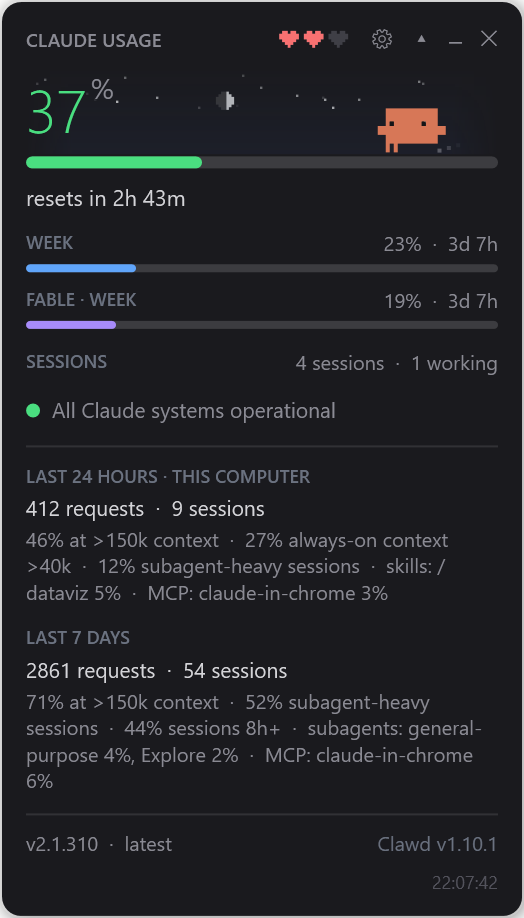

# clawd-usage-winwidget

A tiny floating window + tray icon for Windows that shows how much of your Claude
plan limits you've used — the same numbers as `/usage` in Claude Code, refreshed
every minute. And a pixel Clawd who lives in it and reacts to what your sessions
are doing.


**English** · [Русский](README.ru.md)

- **Official numbers only.** Percentages come from `claude -p "/usage"` — the
  slash command runs headless, talks to Anthropic with your existing login and
  **does not call the model or spend tokens**.
- **No dependencies.** Plain Windows PowerShell 5.1 + WPF, which ship with
  Windows. No Node, no npm, no installer. You only need Claude Code itself.
- **Clawd.** The crab from Claude Code's welcome screen, built from the same block
  glyphs and with the same animations. He sleeps when nothing runs, runs around
  when a session works, waves when a session is waiting for you, sweats near the
  limit and lies belly-up when it's used up.



## Install

Requirements: Windows 10/11 and [Claude Code](https://docs.claude.com/en/docs/claude-code)
installed and logged in (`claude` on `PATH`).

```powershell
git clone https://github.com/Enhed/clawd-usage-winwidget.git
```

or download the ZIP and unpack it anywhere. Then double-click `start-widget.vbs`
(it starts the widget silently, without a console window).

Start with Windows — run once in PowerShell from the widget folder:

```powershell
$a = New-ScheduledTaskAction -Execute "wscript.exe" -Argument "`"$PWD\start-widget.vbs`""
$t = New-ScheduledTaskTrigger -AtLogOn
Register-ScheduledTask -TaskName "clawd usage widget" -Action $a -Trigger $t -RunLevel Limited
```

Only one copy runs at a time, so a manual start next to autostart is harmless.

Windows hides new tray icons in the overflow (`^`). To keep it visible:
Settings → Personalization → Taskbar → Other system tray icons → `clawd-usage-winwidget`.

## What it shows

- **Big number** — current session (the 5-hour window), straight from the server.
  The bar goes green → yellow (60%) → red (85%).
- **resets in 3h 03m** — time until the window resets, from the exact reset time
  in `/usage`.
- **WEEK** — weekly limit and time to reset. **FABLE · WEEK** — the separate
  weekly Fable limit; hidden if `/usage` doesn't report it.
- **SESSIONS** — how many Claude Code sessions are running, how many are
  working and how many are waiting for you. Hover for the list: `▶` working,
  `?` waiting (permission, question, dialog — what exactly is in brackets),
  `○` idle, plus the folder. Handy for catching a forgotten agent quietly
  burning your limit.
- **Service status** — green "All Claude systems operational", or yellow/red
  with the active incident and affected components. Click opens
  status.claude.com.
- **Tray icon** — the same percentage as a colored number; the tooltip adds the
  week and Fable.
- Bottom line — your plan and account email (red "not logged in" if auth
  expired) and the time of the last `/usage` answer, marked "stale" if it's old.

The ▾ in the header expands details (remembered between runs):

- **LAST 24 HOURS / LAST 7 DAYS** — requests, sessions and the "What's
  contributing to your limits usage?" breakdown from `/usage`: share on large
  context, always-on context, subagent-heavy sessions, top MCP servers, skills
  and subagents. Claude Code itself calls this approximate and counts only this
  computer.
- **LIMITS · 7 DAYS** (off by default, `showHistory`) — the 5-hour (green) and weekly (blue) percentages over the
  last week, one line each. Hover for the moment under the cursor: the time, both
  percentages and the project that spent the most in that hour. On the first run
  the chart is filled from the transcripts that `/usage` checks of earlier
  versions left in `~/.claude/projects`; after that every `/usage` answer is a
  sample in `usage-history.json`.
- **PROJECTS · 7 DAYS** — the projects that spent the most this week, by the
  folder they ran in. Counted from Claude Code's transcripts on this computer:
  tokens weighted by the model's price, so the shares are an estimate of what
  went into the limits, not an official figure.
- **Version** — your Claude Code version. If a newer one is out the line turns
  yellow: hover for the official CHANGELOG between your version and the latest,
  click to run `claude update` in a separate window; otherwise a click opens
  Claude Code's changelog. Next to it is the widget's own version: hover for what's
  new in it, click for its `CHANGELOG.md` on GitHub. When a new release of the
  widget is out it turns into a yellow "Clawd X is out" (with a Windows
  notification once per version): hover for what's new, click to download it,
  replace the files and restart — `config.json` and the other local files stay. In a
  git clone the click opens the release page instead. If the new version does not
  come up within five minutes, the old one is put back and started again, and
  the widget says so (and won't offer that version again).

Left-click the tray icon to show/hide the window; right-click for the menu:
refresh, larger/smaller, look the computer over, open config, language, Clawd's session, exit. Drag the window anywhere —
the position is saved.

### Clawd

<table>
<tr>
<td align="center"><br><sub>No Claude Code running — burrows into the sand and sleeps</sub></td>
<td align="center"><br><sub>Click him — a random Claude Code animation and a heart</sub></td>
</tr>
<tr>
<td align="center"><br><sub>Session limit used up — belly-up; click and his soul floats out</sub></td>
<td align="center"><br><sub>The 5-hour window resets — celebration and confetti</sub></td>
</tr>
<tr>
<td align="center"><br><sub>Hearts are his health — the session limit left</sub></td>
<td align="center"><br><sub>The sky follows real time of day and live weather</sub></td>
</tr>
</table>

| situation | Clawd |
|---|---|
| Claude Code isn't running | burrows into the sand and sleeps, "z"s float up |
| sessions are idle | wanders, looks around, follows your cursor, whistles; sometimes waves or stretches |
| 10 minutes with no mouse over the window | dozes standing up, sometimes startles |
| a session is working | runs edge to edge with a focused squint, dust flying |
| a session is waiting for you | wide eyes, jumps and waves, yellow "?" above |
| a session just finished | crouches and throws his arms up, like in Claude Code |
| you click him | a random Claude Code animation — jump, spin, peekaboo, wink, boop, sneeze, coin hop… — and a heart |
| the 5-hour window resets | celebrates: two jumps, green "!", confetti |
| session above the red threshold | sweats and darts his eyes |
| session at 100% | lies belly-up with X eyes; click him and his soul floats out on a string, anime-style |

The three hearts in the header are his health, tamagotchi-style: how much of the
session limit is left. Each half-heart is about 16.7%; zero hearts only at 100%.
Health changes how he behaves on top of everything above — full of energy he
walks faster and hops, tired he yawns and slows down, barely alive he staggers,
sweats and sometimes trips over.

Right-click Clawd for developer mode: force any state, play any animation, set
the hearts, pick time of day and weather, or play everything as a demo.
"Auto" goes back to live data.

### Sky

Behind the numbers there's a faint sky that fades into the window edges. It
follows real sunrise and sunset for your location: the sun moves along an arc,
at night there's the moon in its actual phase and twinkling stars. Weather adds
clouds drifting with the wind, drizzle, rain, showers, snow (that settles under
Clawd's feet), fog and thunderstorms. Hover for city, temperature, weather, wind,
sunrise and sunset.

Weather comes from [Open-Meteo](https://open-meteo.com), falling back to
[met.no](https://api.met.no) where Open-Meteo is blocked; both need no key.
Location is looked up once per run by IP via [ipwho.is](https://ipwho.is) — set
`weatherLat` / `weatherLon` to skip that. Without network the sky still follows
the clock. Turn it off with `showSky`.

### Clawd's panel: tips and chat

An icon in the header opens a panel beside the widget; it stays open until you
close it with the cross or the icon, and stays on top only if the widget does
(`topmost`). The icon tells what's waiting: a bell — a
reminder went off, a blue chat — Clawd answered, a lamp with a number — tips
(yellow if urgent), a grey chat — nothing, just talk.

**Tips.** Every half hour Clawd quietly looks the computer over:

- drives running out of space, and how much sits in Temp, Downloads, the Recycle
  Bin, crash dumps and npm / pip / Yarn / scoop caches;
- new entries in autostart (what was there on the first run is taken as known);
- apps not started for 90+ days — by Windows' own record of launches from Start,
  the taskbar and Explorer; apps in `PATH` or run as services count as used;
- a restart Windows Update is waiting for, a long uptime, a program eating lots of
  memory or keeping the CPU busy two checks in a row.

Each tip links to the right place and has **Do it** (Clawd answers with a script
to approve), **Refine** (your next message goes to him with the tip, e.g. "all
but scoop") and **Dismiss**; it comes back after a
while if it's still true (a day; a month for unused apps). The check is local and
read-only — no network, no tokens. "Look the computer over now" in the tray menu
runs it right away. Turn it off with `showAdvisor`.

**Chat.** Ask Clawd anything about the computer, answer a tip ("clean it all up,
but leave Redis alone") or ask for a reminder ("on Monday at 10 remind me to call
the client", "in 20 minutes — hang the laundry"). Each message is a headless
`claude -p` call in a conversation of its own (your Claude Code sessions are not
touched), with the current tips, time and reminders attached. Clawd may look
around but can't change anything himself: no write tools, MCP servers off, only
read-only commands allowed. A change comes as a script you see in full, with
**Run**, **Refine** (write what to change — the script is replaced) and **Not
now**. **AUTO** in the panel header (`chatAutoRun`, off by default) skips the click:
scripts run as soon as Clawd sends them, up to three in a row before one waits for
you again; Clawd is told about it and asks in words before anything destructive. Reminders are kept by the widget and fire on time with a card to
put them off, a bell in the header and a hop from Clawd — even with the panel
closed. The chat uses your plan's limits; the model is `chatModel` (Sonnet by
default), `showChat` turns it off.

**Reminders and lists.** A reminder that goes off shows as a card in the
bottom-right corner, like a phone notification: put it off — +15m, +1h, +3h,
tomorrow 9:00 or any time — or mark it done; it waits until you answer. The panel has three tabs: Chat, Reminders and Lists.
Reminders shows what's coming (Change, +1 hour, Delete) and a form to add one:
the "when" field understands `18:30`, `tomorrow 10`, `+20m`, `in a week`,
`mon 9:00`, `19.10 14:00` and shows what it made of it; anything else ("next Friday
evening", "1 November") goes on saving to a small model (`quickModel`, Haiku by
default), and only what it can't place either is an error. Lists keeps shopping and any other
lists with checkboxes — add several items at once with commas, tick them off,
remove the ticked ones, start a new list with "+". Both are plain files in Clawd's
home, so the chat ("add milk to shopping") and Clawd on your phone ("what do I need
to buy?") work with the same ones.

**Clawd's home and his own session.** The chat works in Clawd's home folder
(`clawdHome`). Reminders are plain files there (lists too, in `lists\`) —
`reminders\2026-11\2026-11-16 10-00 Pay the taxes.md` with an `at:` line — so
anyone can make one: the chat, Clawd's session, or you by hand; fired ones move to
`reminders\done`. After each check the tips are written to `tips.md` there. With
`clawdSession` the widget also keeps Clawd's own interactive Claude Code session
running in that folder with Remote Control — talk to him from the Claude app on
your phone: he reads `tips.md`, makes reminders and keeps notes in the same home.
He is told about all this by `clawd-session-prompt.md`. While that session is
idle Clawd can still fall asleep; when you talk to him he runs around.

**Recurring tasks.** Something Clawd does by himself every so often: look at the
mail, check a site, watch a folder. A task is a file `tasks\<name>.md` in his home:

```
---
every: 10m
tools: mcp__mail
hours: 8-23
---
Check the inbox for mail since the last run. Tell me only about letters from
people and anything urgent.
```

The widget runs a due one as a background `claude -p` in Clawd's home, with the
usual context and his last report, so he says only what's new. Most runs end with
nothing to say and you see nothing; otherwise the reply lands in the chat with a
notification. `tools` — what it may use besides reading, space-separated: an MCP
server as `mcp__<server>`, a command as a Claude Code rule like
`PowerShell(gh issue list:*)`, a site as `WebFetch(domain:github.com)`. A task
runs in the background and can't ask, so when a run is refused something the chat
shows a card with the missing rules and **Allow** — it adds them to the file and
runs the task again; `model` — instead of `quickModel`; `hours` — only between these
hours; `paused: yes`. Ask in the chat ("check my mail every 10 minutes"), put
"every 30 minutes" in the reminder form's "when" (it hands that to the chat), ask from
the phone, or write the file yourself; the Reminders tab lists them with Run now,
Pause, Open and Delete; a click on a task shows its latest reports. A script a
task proposes always waits for a click. Each run uses your plan's limits, so tasks
wait while the five-hour session or the week is at `tasksMaxPercent` (80%) or
more — the Reminders tab says so; `limit: 60` in a task file sets its own
threshold. `showTasks` turns them off.

The chat may use the tools you gave your tasks too, so "move it to the trash"
after a mail report works. Without AUTO it reads at once, but an action (move,
mark read, send) shows up as a card with the exact call and **Run** / **Not now**;
with AUTO it just happens. Mail goes out only after Clawd shows the draft and you
say yes.

The panel and the phone are two conversations with one Clawd: the panel shows the
phone conversation in the same feed (marked "Remote Control"), its chat gets the
latest part of it as context, and the panel's conversation is written to
`chat-log.md` in the home for the phone session to read. "+" in the panel starts
a new conversation there and hides the phone conversation so far; on the phone
`/clear` starts a new one in the same Remote Control entry, and the feed follows.

## Where the data comes from

| what | source | how often |
|---|---|---|
| limits and stats | `claude -p "/usage" --output-format text` | every 60 s |
| sessions | `~/.claude/sessions/<pid>.json`, kept by Claude Code itself; only live processes count | every tick |
| account | `claude auth status` | every 10 min |
| latest version | `downloads.claude.ai/claude-code-releases/latest` (or `stable` if `autoUpdatesChannel` says so) — the same URL the official installer uses | hourly |
| changelog | `raw.githubusercontent.com/anthropics/claude-code/main/CHANGELOG.md` | only when an update is available |
| widget release | `api.github.com/repos/Enhed/clawd-usage-winwidget/releases/latest` | hourly |
| status | `status.claude.com/api/v2/summary.json` | every 2 min |
| weather | Open-Meteo / met.no, location via ipwho.is | every 15 min |

`/usage` takes about two seconds, so it runs asynchronously and the window never
freezes. If it doesn't answer, the widget keeps the last numbers and marks them
stale.

> Don't run `claude -p "/usage"` by hand from Git Bash: MSYS rewrites `/usage`
> into a path (`C:/Program Files/Git/usage`) and the prompt goes to the model,
> spending tokens. PowerShell and cmd are fine.

## config.json

Created next to the script on first save; open it from the tray menu. Changes
are picked up on the fly, no restart needed.

| key | meaning |
|---|---|
| `language` | `en`, `ru` or `fr` (also in the tray menu) |
| `scale` | window scale, 0.6–4.0 (default 1.35; also "Larger" / "Smaller" in the tray menu) |
| `opacity` | window opacity, 0–1 |
| `topmost` | keep the window above all others |
| `trayResetClock` | tray tooltip shows resets as clock times (`5h: 36% (resets 03:20)`, `7d: 81% (resets tmrw 01:00)`) instead of a countdown |
| `warnPercent` / `critPercent` | yellow and red thresholds |
| `expanded` | details expanded |
| `showStats` / `showStatus` / `showSessions` / `showAccount` | show the corresponding block |
| `showHistory` | the 7-day chart and top projects in details (off by default) |
| `showMascot` / `showSky` | Clawd and the sky behind him |
| `weatherLat` / `weatherLon` | coordinates for weather; empty — by IP |
| `showAdvisor` | Clawd's tips about the computer |
| `showChat` / `chatModel` / `chatTimeoutSeconds` | the chat with Clawd; its model; a reply taking longer is cancelled (300 s) |
| `chatAutoRun` | run Clawd's scripts without the Run click (the AUTO toggle in the panel) |
| `quickModel` | model for small jobs: an unclear reminder time, recurring tasks (`haiku`) |
| `showTasks` | run recurring tasks from `tasks\` in Clawd's home |
| `tasksMaxPercent` | tasks wait while the session or the week is at this percent or more (80; 100 — never wait) |
| `advisorDiskGB` / `advisorJunkGB` | free space to warn below; size of temp files and caches worth mentioning, GB |
| `advisorUnusedDays` / `advisorUptimeDays` / `advisorMemPercent` | when an app counts as unused; when to suggest a restart; memory share of one program worth a word |
| `runAsAdmin` | run the widget itself as administrator: at start it asks UAC and restarts elevated (declined — runs as usual). Elevated, the tips also read Prefetch (the exact last start of every program, terminal ones included), Windows Temp and Windows Update downloads |
| `clawdHome` | Clawd's home folder: the chat works there, reminders and `tips.md` live there, and so does his own session; empty — `%USERPROFILE%\Clawd` |
| `clawdSession` | keep Clawd's own Claude Code session running in his home with Remote Control (named after the widget, `clawdSessionName`), to talk to him from the phone or claude.ai (default off; also in the tray menu). Started with the widget and again if it's gone; starts its own conversation and comes back to it. Skipped while another session runs in that folder |
| `clawdSessionAdmin` / `clawdSessionHidden` | run that session as administrator; without a window (default on; a folder Claude Code hasn't trusted yet still opens in a window, to answer the trust question) |
| `refreshSeconds`, `usageIntervalSeconds`, `versionIntervalSeconds`, `statusIntervalSeconds`, `accountIntervalSeconds`, `weatherIntervalSeconds`, `advisorIntervalMinutes` | polling periods, seconds |
| `left` / `top` | window position, written when you drag it |

## Troubleshooting

Errors in the update loop never crash the widget: the bottom-right corner shows
"error" and details go to `widget-error.log` next to the script.

If you edit the scripts: `.ps1` files must stay **UTF-8 with BOM** — without it
Windows PowerShell 5.1 reads them as ANSI and breaks on non-ASCII text. Syntax
check:

```powershell
foreach ($f in @('.\widget.ps1') + (Get-ChildItem .\lib\*.ps1).FullName) {
    $err = $null
    [void][System.Management.Automation.Language.Parser]::ParseFile((Resolve-Path $f), [ref]$null, [ref]$err)
    if ($err) { $f; $err }
}
```

## How it's built

`widget.ps1` is the entry point: single instance, loads the modules from `lib\`
and runs the WPF loop. The window layout is in `widget.xaml`. Modules are
dot-sourced into one shared script scope in a fixed order; each may rely on the
ones loaded before it. All UI text lives in `lib\i18n.ps1` — adding a language
is one more table there.

`self-update.ps1` replaces the files on an update and rolls back if the new
version doesn't start. `tools\smoke.ps1` is the pre-release check: it starts a
copy of the working tree in a sandbox (own folder, TEMP and mutex — the running
widget is not touched), with the junk that once hung it, and checks an update
and a rollback through `self-update.ps1`.

`tools/` also holds the recorder that made the GIFs in this README: it boots the
widget with scripted fake data and renders frames straight from WPF. It needs
ffmpeg and Pillow; the widget itself doesn't.

## Ports

The widget is Windows-only, but the data behind it is simple: `claude -p /usage`
for the limits and `~/.claude/sessions` for live sessions.
[docs/PORTING.md](docs/PORTING.md) describes the formats, the parsing gotchas,
Clawd's moods and the hearts — enough to build it for macOS, Linux, a phone or a
status bar. Made a port? Open an issue with a link and it'll be listed here.

## License

[MIT](LICENSE)

---

Not affiliated with Anthropic. Clawd and Claude are Anthropic's.
