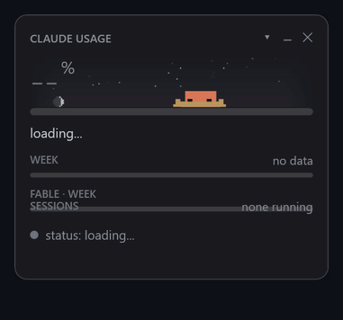
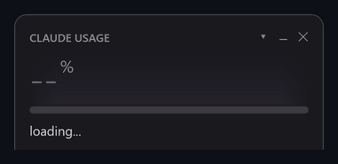
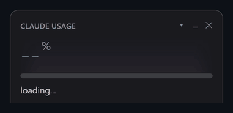
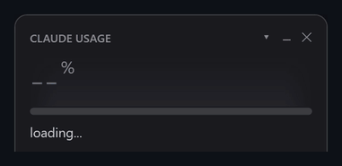
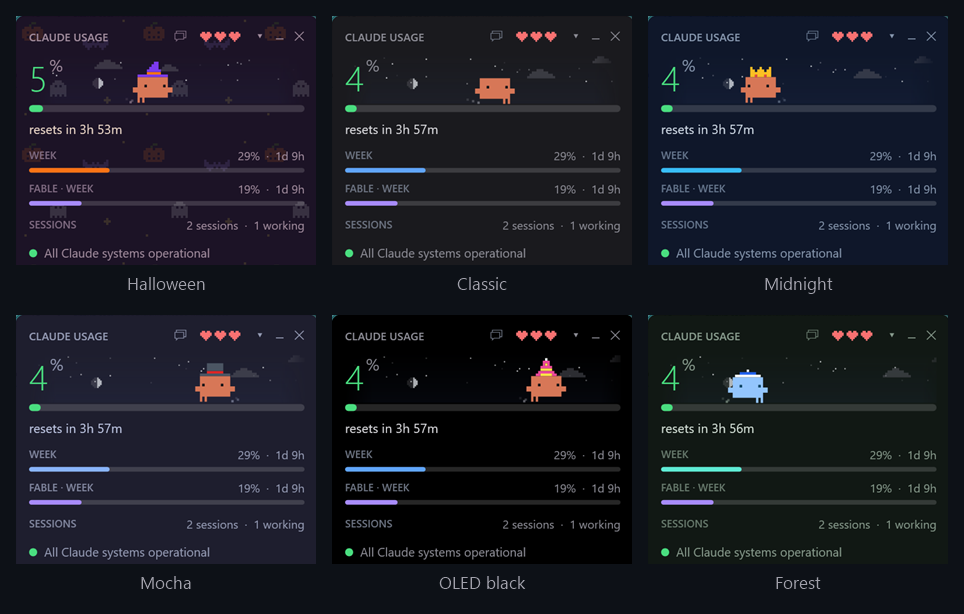
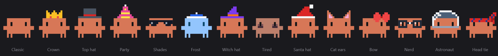

# clawd-usage-winwidget

Плавающее окошко + иконка в трее с текущим расходом Claude.
Все данные — официальные, те же, что показывает `/usage`. Без сторонних зависимостей.



[English](README.md) · **Русский**

Язык интерфейса по умолчанию английский; русский (или французский) включается в
настройках (шестерёнка в заголовке окна → Look → Русский) или ключом `"language": "ru"` в
`config.json`.

## Запуск

Нужны Windows 10/11 и установленный, залогиненный [Claude Code](https://docs.claude.com/en/docs/claude-code).

```powershell
git clone https://github.com/Enhed/clawd-usage-winwidget.git
```

или скачать ZIP и распаковать куда угодно. Дальше — двойной клик по `start-widget.vbs` (тихо, без мелькания консоли).

Автозапуск при входе в систему — один раз из папки виджета:

```powershell
$a = New-ScheduledTaskAction -Execute "wscript.exe" -Argument "`"$PWD\start-widget.vbs`""
$t = New-ScheduledTaskTrigger -AtLogOn
Register-ScheduledTask -TaskName "clawd usage widget" -Action $a -Trigger $t -RunLevel Limited
```

## Что показывает

Все цифры официальные — от Anthropic через `/usage` Claude Code. Сторонних
зависимостей (npm-пакетов, ccusage и т.п.) нет: нужны только Windows PowerShell 5.1
и установленный Claude Code.

- **Большой процент** — заполнение текущей сессии (5-часового окна), цифра с сервера.
- Полоса под ним: зелёная → жёлтая (60%) → красная (85%).
- `сброс через 3ч 03м` — до конца окна, по точному времени из `/usage`.
- **НЕДЕЛЯ** — процент недельного лимита и время до сброса.
- **FABLE · НЕДЕЛЯ** — отдельный недельный лимит на Fable; если `/usage` его не
  прислал, строка прячется.
- **СЕССИИ** — сколько сессий Claude Code запущено и сколько из них сейчас в
  работе, а если кто-то ждёт тебя — сколько ждут. Какие именно — по наведению:
  `▶` — Claude что-то делает, `?` — ждёт ответа (разрешение, вопрос, диалог;
  в скобках — что именно), `○` — простаивает, рядом папка. Удобно ловить
  забытого агента, который тихо жжёт лимит.

  Сессии на другой машине (домашний сервер, виртуалка) добавляются ключом
  `remoteSessions` в `config.json` — списком URL или путей к файлам, каждый
  отдаёт живые сессии той машины в формате `~/.claude/sessions/<pid>.json`:

  ```json
  { "generatedAt": "2026-10-17T03:41:47+00:00", "host": "unraid",
    "sessions": [ { "name": "api", "status": "busy", "waitingFor": "",
                    "kind": "interactive", "sessionId": "4b8ca9ab-..." } ] }
  ```

  Отдавать нужно только живые сессии, `cwd` необязателен. Они учитываются в
  строке и в настроении Clawd, в списке по наведению рядом виден `host`.
  Источник, который не ответил, завис или прислал `generatedAt` старше двух
  минут, ничего не добавляет.
- **Статус сервисов** — точка и строка под полосами. Зелёная «Claude работает
  штатно», жёлтая или красная — название активного инцидента и сбоящие компоненты
  (`Claude Code: частичный сбой`). Клик открывает status.claude.com. Если страница
  статуса долго не отвечает — серая «статус: нет связи».
- Иконка в трее — тот же процент цифрой, цвет по тем же порогам. В тултипе ещё
  неделя и Fable. Тултип обрезается до 63 символов — это жёсткий предел
  `NotifyIcon.Text`, при превышении Windows бросает исключение.
- Внизу слева — план и почта аккаунта (`Max · …`). Если авторизация слетела,
  там красным будет «не залогинен».
- В правом нижнем углу — время последнего ответа `/usage`; если он давно не
  обновлялся, перед временем появляется «устарело».

### Маскот

<table>
<tr>
<td align="center"><br><sub>Claude Code не запущен — закапывается в песок и спит</sub></td>
<td align="center"><br><sub>Клик по нему — случайная анимация из Claude Code и сердечко</sub></td>
</tr>
<tr>
<td align="center"><br><sub>Лимит сессии выбран — лапами вверх, по клику выходит дух</sub></td>
<td align="center"><br><sub>5-часовое окно сбросилось — праздник и конфетти</sub></td>
</tr>
<tr>
<td align="center"><br><sub>Сердца — его здоровье, то есть остаток лимита сессии</sub></td>
<td align="center"><br><sub>Небо идёт за реальным временем суток и погодой</sub></td>
</tr>
</table>

Справа от процента живёт пиксельный Clawd из приветствия
Claude Code — собран из тех же блочных глифов, что и в терминале, и с теми же
анимациями. Что он делает, зависит от тех же данных:

| ситуация | Clawd |
|---|---|
| Claude Code не запущен | закапывается в песок и спит в норе, всплывают «z» |
| сессии простаивают | бродит, озирается, следит за курсором, насвистывает (♪); иногда машет, потягивается |
| 10 минут тишины без мыши над окном | дремлет стоя с полуприкрытыми глазами, иногда вздрагивает и таращится |
| какая-то сессия работает | бегает от края до края с сосредоточенным прищуром, из-под ног летит пыль |
| сессия ждёт ответа | глаза широко открыты, подпрыгивает и машет, над головой жёлтый «?» |
| сессия доделала ответ | приседает и вскидывает руки, как в Claude Code |
| клик по нему | случайная анимация из Claude Code: прыжок, оглядывается, вертится, ку-ку, падает сверху, подмигивает, буп, топчется, чихает, поворачивается, монетка — и сердечко |
| запуск виджета | выходит на сцену одной из анимаций Claude Code (ещё вприпрыжку, вперевалку, выглядывает) |
| 5-часовое окно сбросилось | празднует: два прыжка, зелёный «!», конфетти |
| сессия за красным порогом | потеет и нервно бегает глазами |
| сессия выбрана на 100% (0 сердец) | лежит лапами вверх с крестиками на глазах, лапы подёргиваются по клику, как в аниме, у него открывается рот и на ниточке вылетает дух, висит и со свистом втягивается обратно |

В заголовке, как в тамагочи, три сердца — здоровье Clawd, то есть сколько осталось
лимита текущей сессии. Каждая половинка — примерно 16,7% остатка, ноль сердец
бывает только на 100%. Потерянная половинка пару секунд мигает, когда осталось
одно сердце или меньше, сердца бьются. По наведению — уровень и точный остаток.
Клик по Clawd — над ним всплывает сердечко.

Уровень сердец — его здоровье, оно накладывается на любой режим из таблицы выше:

| сердца | состояние | как видно |
|---|---|---|
| 3 | полон сил | ходит быстрее, иногда подпрыгивает от радости |
| 2½ | в норме | обычное поведение |
| 2 | подустал | чуть медленнее, иногда зевает |
| 1½ | устал | медленнее, глаза полуприкрыты, зевает чаще |
| 1 | вымотан | еле переставляет ноги, потеет, больше не прыгает и не насвистывает |
| ½ | еле живой | глаза-щёлочки, шатается, потеет, иногда спотыкается и плюхается на попу |
| 0 | лимит исчерпан | лежит лапами вверх с крестиками на глазах |

ПКМ по маскоту — режим разработчика: можно включить любое состояние, проиграть
любую анимацию, включить пот, выставить число сердец, проиграть потерю сердец
до нуля, выбрать время суток и погоду для неба или запустить демо всего по очереди. Пока режим
включён, над маскотом подписано, что показывается. «Авто» возвращает его к
реальным данным. Выключается целиком ключом `showMascot`.

### Небо

На всю строку с процентами и Clawd — едва заметное небо, которое растворяется в
фоне окна к краям:

- **время суток** — оттенок у «горизонта» плавно меняется от ночного синего к
  рассветному, дневному и закатному по реальным восходу и закату для твоего
  места; днём по дуге идёт солнце (у горизонта рыжеет), ночью — луна в
  настоящей фазе и мерцающие звёзды;
- **погода** — облака (их число по облачности, плывут по ветру), морось,
  дождь и ливень (косят по ветру), снег (под ногами ложится белая полоска),
  туман, гроза со вспышками. В пасмурную погоду небо выцветает, солнце и
  звёзды прячутся.

По наведению на небо — город, температура, погода, ветер, восход и закат, фаза луны («первая четверть, освещена на 42%»).
Погода спрашивается раз в 15 минут у [Open-Meteo](https://open-meteo.com),
а если он недоступен (в некоторых сетях заблокирован) — у
[met.no](https://api.met.no). Оба без ключа. Место определяется один раз за
запуск по IP через [ipwho.is](https://ipwho.is); чтобы не светить IP, задай
координаты в `weatherLat` / `weatherLon`. Восход и закат, если погода их не
прислала, считаются локально по координатам. Без сети небо всё равно идёт по
времени суток, только без погоды.

Треугольник в заголовке разворачивает подробности (состояние запоминается):

- **ЗА 24 ЧАСА / ЗА 7 ДНЕЙ** (отключаются ключом `showStats`) — запросы и сессии, доля расхода на большом контексте,
  на постоянном контексте, в сессиях с сабагентами, топ MCP-серверов, скиллов и
  сабагентов. Это блок «What's contributing to your limits usage?» из `/usage`;
  по словам самого Claude Code, он приблизительный и учитывает только сессии на этом
  компьютере. Незнакомые строки выводятся как есть, по-английски.
- **ЛИМИТЫ · 7 ДНЕЙ** (по умолчанию выключено, ключ `showHistory`) — пятичасовой (зелёный) и недельный
  (синий) проценты за последнюю неделю, по линии на каждый. По наведению видно
  момент под курсором: время, оба процента и проект, который больше всех потратил
  в тот час. При первом запуске график заполняется из транскриптов, которые
  оставили в `~/.claude/projects` проверки `/usage` прошлых версий; дальше каждый
  ответ `/usage` — точка в `usage-history.json`.
- **ПРОЕКТЫ · 7 ДНЕЙ** — проекты, потратившие больше всего за неделю, по папке, в
  которой шла работа. Считается по транскриптам Claude Code на этом компьютере:
  токены, взвешенные по цене модели, так что доли — оценка того, что ушло в
  лимиты, а не официальная цифра.
- **Версия** — текущая версия Claude Code. Если вышла новее, строка желтеет:
  по наведению — список изменений из официального CHANGELOG (все версии между
  твоей и последней, первые 25 пунктов), по клику — `claude update` в отдельном
  окне. Когда обновление закончится, версия перепроверится сама.
  Без обновления клик открывает список изменений Claude Code. Справа — версия
  самого виджета: по наведению — что в ней нового, по клику — его `CHANGELOG.md` на GitHub.
  Когда выходит новый релиз виджета, она становится жёлтым «есть Clawd X» (и один
  раз на версию приходит уведомление Windows): по наведению — что нового, по клику
  виджет скачает релиз, заменит файлы и перезапустится; `config.json` и другие
  локальные файлы остаются. В git-клоне клик открывает страницу релиза. Если новая
  версия не поднялась за пять минут, виджет вернёт старую, запустит её и скажет
  об этом (и эту версию больше не предложит).

Windows по умолчанию прячет иконку нового процесса в переполнение (стрелка `^`
слева от трея). Чтобы закрепить её на виду: Параметры → Персонализация →
Панель задач → Другие значки в системном трее → включить `clawd-usage-winwidget`.
Программно это не переключается.

Левый клик по иконке — показать/скрыть окно. Правый — меню
(показать/скрыть, обновить, настройки, выход).

**Настройки** — шестерёнка в заголовке окна (или меню трея): язык, тема, скин
Clawd на карточках с живым предпросмотром (под мышью он поднимает лапки),
размер, непрозрачность, «поверх всех окон», какие блоки показывать в окне,
советы, чат, повторяющиеся задачи и сессия Clawd. Всё применяется сразу;
остальные ключи — в `config.json`, ссылка на него внизу окна.

Размер задаётся ключом `scale` (по умолчанию 1.35) или в настройках
(вкладка «Окно») с шагом 0,1, диапазон 0,6–4,0. Масштабируется всё окно целиком
трансформой на корневом элементе, поэтому пропорции и толщина полос сохраняются.
Размер иконки в трее задаёт Windows, его это не меняет.
Окно перетаскивается мышью, позиция сохраняется сразу после перетаскивания.

### Темы и скины



**Темы** — Настройки → Вид: Хэллоуин, Классическая, Полночь, Мокко, Чёрная
(OLED), Лес; переключаются сразу. У Хэллоуина на фоне узор из маленьких тыкв,
летучих мышей и привидений. По умолчанию стоит «По сезону»: с сентября по ноябрь
Хэллоуин, в остальное время классическая. Ключ `accent` в `config.json` (`"#F472B6"`) задаёт свой цвет
ссылок и недельной полосы поверх цвета темы. Цвета уровней на полосах, небо и
Clawd от темы не зависят.



**Скины Clawd** — Настройки → Вид, с предпросмотром каждого. Скин — это его цвета и пиксельные
аксессуары, которые двигаются вместе с ним: шляпа видна, пока голова в кадре, а
лёжа на спине он её теряет. Свой: последняя карточка «Свои» открывает папку,
положи туда `.txt` (имя файла — его id; то же имя, что у встроенного, заменяет
его) и выбери его карточку. Правки видны через несколько секунд:

```
---
name: Цилиндр
body: #D77757
eyes: #141416
k: #4B5563
r: #DC2626
---
......kkkkkkk.....
......kkkkkkk.....
......kkkkkkk.....
......rrrrrrr.....
...kkkkkkkkkkkkk..
```

`body` и `eyes` необязательны. Каждый ключ из одной буквы — цвет этой буквы в
рисунке ниже, `.` — пусто. Рисунок шириной 18 пикселей, как Clawd, и стоит прямо
на голове; `top: 1` (любой номер строки) ставит его первую строку в другое место,
считая от верхней строки Clawd. Сам Clawd, `#` — тело, `o` — глаза:

```
  0 ...#############..
  1 ...#############..
  2 ...##o#######o##..
  3 ...##o#######o##..
  4 .#################
  5 .#################
  6 ...#############..
  7 ...#############..
  8 ...#.#.......#.#..
  9 ...#.#.......#.#..
```

Встроенные лежат в папке [`skins`](skins) — в `shades.txt` пример аксессуара на
лице (`top: 1`).

### Панель Clawd: советы и чат

Значок в заголовке открывает панель рядом с виджетом; она остаётся открытой, пока
не закроешь её крестиком или тем же значком, и держится поверх окон, только если
так настроен сам виджет (`topmost`). Значок подсказывает, что там ждёт:
колокольчик — сработало напоминание, синий чат — Clawd ответил, лампочка с числом —
советы (жёлтая, если срочно), серый чат — ничего, можно просто поговорить.

**Советы.** Раз в полчаса Clawd тихо осматривает компьютер:

- кончается ли место на дисках и сколько лежит в Temp, Загрузках, Корзине,
  дампах сбоев и кэшах npm / pip / Yarn / scoop;
- новое в автозагрузке (то, что было там при первом запуске, считается известным);
- программы, которые не запускались 90+ дней, — по записям самой Windows о
  запусках из «Пуска», панели задач и Проводника; программы из `PATH` и те, что
  работают службами, считаются используемыми;
- ждёт ли Windows Update перезагрузки, давно ли компьютер не перезагружался, не
  съедает ли программа много памяти и не грузит ли процессор две проверки подряд.

У каждого совета ссылка на нужное место и кнопки **Сделать** (Clawd ответит
скриптом на подтверждение), **Уточнить** (следующее сообщение уйдёт ему вместе с
советом, например «всё, кроме scoop») и **Скрыть**; скрытый вернётся через время,
если всё ещё актуален (через день; для неиспользуемых программ — через месяц).
Проверка локальная и только на чтение — без сети и без токенов. Пункт «Проверить
компьютер сейчас» в настройках (вкладка Clawd) запускает её сразу. Выключается ключом `showAdvisor`.

**Чат.** Спрашивай Clawd что угодно про компьютер, отвечай на советы («давай всё
почистим, но редис не трогай») или проси напомнить («в понедельник в 10 напомни
позвонить клиенту», «через 20 минут — развесить вещи»). Каждое сообщение — вызов
`claude -p` в отдельном разговоре (твои сессии Claude Code он не трогает), к нему
прикладываются текущие советы, время и напоминания. Clawd может осмотреться, но
сам ничего не меняет: без инструментов записи, без MCP-серверов, разрешены только
команды на чтение. Изменение приходит скриптом, который виден целиком, с кнопками
**Выполнить**, **Уточнить** (напиши, что поменять, — скрипт заменится) и **Не
надо**. **АВТО** в шапке панели (`chatAutoRun`, по умолчанию выключено) убирает
нажатие: скрипт выполняется сразу, как Clawd его прислал, — до трёх подряд, потом
следующий снова ждёт тебя; Clawd об этом знает и перед чем-то необратимым сначала
спрашивает словами. Напоминания хранит виджет и срабатывает вовремя: карточка с «отложить»,
колокольчик в заголовке и прыжок Clawd — даже при закрытой панели. Чат расходует
лимиты твоей подписки; модель — `chatModel` (по умолчанию Sonnet), выключается
ключом `showChat`.

**Напоминания и списки.** Сработавшее напоминание показывается карточкой в правом
нижнем углу, как уведомление на телефоне: отложить — +15м, +1ч, +3ч, завтра 9:00
или на любое время — или «Готово»; карточка ждёт ответа. В панели три вкладки: Чат, Напоминания и Списки. На
вкладке напоминаний — что впереди («Изменить», «+1 час», «Удалить») и форма
добавления: поле «Когда» понимает `18:30`, `завтра 10`, `+20м`, `через неделю`,
`пн 9:00`, `19.10 14:00` и сразу показывает, что из этого вышло; всё остальное
(«в следующую пятницу вечером», «1 ноября») при сохранении уходит маленькой модели
(`quickModel`, по умолчанию Haiku), и ошибка — только если не поняла и она. Списки — покупки и любые
другие с галочками: несколько пунктов сразу через запятую, отметить, убрать
отмеченное, новый список — «+». Всё это обычные файлы в доме Clawd, поэтому и чат
(«добавь молоко в покупки»), и Clawd на телефоне («что мне купить?») работают с
теми же списками.

**Дом Clawd и его собственная сессия.** Чат работает в домашней папке Clawd
(`clawdHome`). Напоминания — обычные файлы в ней (списки тоже, в `lists\`):
`reminders\2026-11\2026-11-16 10-00 Заплатить налоги.md` со строкой `at:`, — так
что создать их может кто угодно: чат, сессия Clawd или ты сам; сработавшие
переезжают в `reminders\done`. Строка `repeat:` (`daily`, `weekly`, `monthly`,
`yearly`) делает напоминание повторяющимся: сработав, виджет сам пишет файл на
следующий раз — «напоминай каждое 17-е» это один файл, на вкладке напоминаний он
отмечен ↻. После каждой проверки советы записываются туда же в
`tips.md`. С ключом `clawdSession` виджет ещё и держит запущенной собственную
интерактивную сессию Claude Code Clawd в этой папке с Remote Control — говори с ним
из приложения Claude на телефоне: он читает `tips.md`, ставит напоминания и ведёт
заметки в том же доме. Обо всём этом ему рассказывает `clawd-session-prompt.md`.
Пока сессия простаивает, Clawd всё так же засыпает; когда ты с ним говоришь — бегает.

**Повторяющиеся задачи.** То, что Clawd делает сам время от времени: смотрит
почту, проверяет сайт, следит за папкой. Задача — файл `tasks\<имя>.md` в его доме:

```
---
every: 10m
tools: mcp__mail
hours: 8-23
---
Проверь почту с прошлого запуска. Говори только о письмах от людей и срочном.
```

Виджет запускает подошедшую фоновым `claude -p` в доме Clawd с обычным контекстом
и его прошлым отчётом — так он говорит только о новом. Обычно сказать нечего, и ты
ничего не видишь; иначе ответ приходит в чат с уведомлением. `tools` — что можно
кроме чтения, через пробел: MCP-сервер — `mcp__<сервер>`, команда — правилом
Claude Code вроде `PowerShell(gh issue list:*)`, сайт — `WebFetch(domain:github.com)`.
Задача работает в фоне и спросить не может, поэтому, если ей чего-то не хватило,
в чате появляется карточка с недостающими правилами и кнопкой **Разрешить** — она
допишет их в файл и запустит задачу снова; `model` — вместо `quickModel`;
`hours` — только в эти часы; `paused: yes`. Вместо `every` можно `at: 09:00, 18:00` —
запуск в эти часы, по разу, а если ПК в это время был выключен — один раз при
включении: утренняя сводка стоит один запуск в день, а не каждые десять минут. Попроси в чате («проверяй почту раз в
10 минут»), напиши «раз в полчаса» в поле «Когда» у напоминания (форма передаст
это в чат), попроси с телефона или напиши файл сам; на вкладке напоминаний они видны с
«Сейчас», «Пауза», «Открыть» и «Удалить»; клик по задаче показывает по строке на каждый
из последних запусков (ярче — то, о чём тебе сообщили), и эти же строки получает
следующий запуск как память о прошлых. Скрипт от задачи всегда ждёт нажатия. Каждый запуск расходует лимиты
подписки, поэтому задачи ждут, пока сессия или неделя на `tasksMaxPercent` (80%)
и выше, — на вкладке это видно; `limit: 60` в файле задачи задаёт ей свой порог.
Выключаются ключом `showTasks`.

Чату доступны инструменты, которые ты выдал задачам, поэтому «перемести в
корзину» после отчёта о почте работает. Без АВТО читать он может сразу, а
действие (переместить, отметить прочитанным, отправить) приходит карточкой с
точным вызовом и кнопками **Выполнить** / **Не надо**; с АВТО — выполняется сразу.
Письмо уходит только после того, как Clawd покажет черновик и ты скажешь «да».

Панель и телефон — два разговора с одним Clawd: панель показывает переписку с
телефона в той же ленте (с пометкой «Remote Control»), её чат получает последнюю
часть этой переписки в контексте, а разговор из панели пишется в `chat-log.md` в
доме, и сессия на телефоне его читает. «+» в панели начинает новый разговор в ней и
скрывает прежнюю переписку с телефона; на телефоне новый разговор начинает `/clear`
— в той же записи Remote Control, и лента переходит на него.

## Откуда данные

**Проценты и статистика — раз в 60 секунд:**

```
claude -p "/usage" --output-format text
```

Это обычная слэш-команда в headless-режиме. Она ходит на сервер по той авторизации,
которая уже есть у Claude Code, и отдаёт ровно то же, что `/usage` в интерактиве:

```
Current session: 15% used · resets Sep 16, 7:30am (Europe/Moscow)
Current week (all models): 6% used · resets Sep 21, 6am (Europe/Moscow)
Current week (Fable): 0% used · resets Sep 21, 6am (Europe/Moscow)
```

Обращения к модели тут нет, токены не тратятся. Вызов занимает ~2 секунды, поэтому
запускается асинхронно: окно в это время не подвисает. Если `/usage` не ответил,
виджет показывает последние полученные цифры и помечает их «устарело»; повтор —
через тот же интервал.

`~/.claude` здесь — собственная папка Claude Code: если задана переменная
`CLAUDE_CONFIG_DIR`, виджет, как и сам Claude Code, читает сессии, транскрипты,
`settings.json` и `.claude.json` оттуда.

Запускать это вручную из Git Bash нельзя как есть: MSYS превращает `/usage` в путь
`C:/Program Files/Git/usage`, и запрос уходит модели. Из PowerShell/cmd всё нормально.

**Версия — раз в час:** `claude --version` локально против
`https://downloads.claude.ai/claude-code-releases/latest` — того же адреса, по
которому номер последнего релиза узнаёт официальный установщик
(`https://claude.ai/install.ps1`). Если в `~/.claude/settings.json` задан
`autoUpdatesChannel: "stable"`, спрашивается `…/stable`. Тогда же — последний
релиз самого виджета: `api.github.com/repos/Enhed/clawd-usage-winwidget/releases/latest`.

**Статус сервисов — раз в 2 минуты:** `https://status.claude.com/api/v2/summary.json`,
официальная страница статуса Anthropic. Запрос асинхронный.

**Сессии — каждый тик:** `~/.claude/sessions/<pid>.json` — реестр, который ведёт
сам Claude Code (имя, папка, статус `busy`/`idle`). Файл может пережить процесс,
поэтому учитываются только живые процессы с совпадающим временем старта.

**Аккаунт — раз в 10 минут:** `claude auth status` (JSON, без обращения к модели).

**Список изменений — только при наличии обновления:**
`https://raw.githubusercontent.com/anthropics/claude-code/main/CHANGELOG.md`.

## config.json

| ключ | смысл |
|---|---|
| `language` | язык интерфейса: `en` (по умолчанию), `ru` или `fr` |
| `refreshSeconds` | период перерисовки окна, сек |
| `usageIntervalSeconds` | период опроса `/usage`, сек |
| `versionIntervalSeconds` | период проверки обновления, сек |
| `expanded` | развёрнут ли блок подробностей |
| `warnPercent` / `critPercent` | пороги жёлтого и красного |
| `scale` | масштаб окна, 0,6–4,0 |
| `opacity` | прозрачность окна, 0–1 |
| `topmost` | держать окно поверх всех окон (по умолчанию `false`) |
| `trayResetClock` | подсказка в трее показывает сброс часами (`5ч: 36% (сброс 03:20)`, `7д: 81% (сброс завтра 01:00)`), а не обратным отсчётом |
| `showStats` | показывать блоки «за 24 часа» / «за 7 дней» в подробностях |
| `showHistory` | показывать график за 7 дней и топ проектов в подробностях (по умолчанию `false`) |
| `showStatus` | показывать строку статуса сервисов |
| `statusIntervalSeconds` | период опроса status.claude.com, сек |
| `showSessions` | показывать блок сессий Claude Code |
| `remoteSessions` | сессии на других машинах: список URL или путей к файлам, см. ниже |
| `showAccount` | показывать план и почту внизу окна |
| `accountIntervalSeconds` | период опроса `claude auth status`, сек |
| `showMascot` | анимированный Clawd над полосой сессии (см. ниже) |
| `showSky` | небо за маскотом: время суток и погода (см. ниже) |
| `theme` | тема: `auto` (по сезону: осенью `halloween`, иначе `classic`), `classic`, `midnight`, `mocha`, `oled`, `forest`, `halloween` (есть в настройках) |
| `accent` | свой цвет акцента, `#RRGGBB`, поверх цвета темы |
| `skin` | скин Clawd: встроенный или свой из `<clawdHome>\skins` (есть в настройках) |
| `weatherIntervalSeconds` | период опроса погоды, сек |
| `advisorIntervalMinutes` | как часто осматривать компьютер, мин |
| `weatherLat` / `weatherLon` | координаты для погоды; пусто — по IP |
| `showAdvisor` | советы Clawd о компьютере |
| `showChat` / `chatModel` / `chatTimeoutSeconds` | чат с Clawd; его модель; ответ дольше этого прерывается (300 с) |
| `chatAutoRun` | скрипты Clawd без нажатия «Выполнить» (переключатель АВТО в панели) |
| `quickModel` | модель для мелочей: непонятное «когда», повторяющиеся задачи (`haiku`) |
| `showTasks` | запускать повторяющиеся задачи из `tasks\` в доме Clawd |
| `tasksMaxPercent` | задачи ждут, пока сессия или неделя на этом проценте и выше (80; 100 — не ждать) |
| `advisorDiskGB` / `advisorJunkGB` | порог свободного места; сколько временных файлов и кэшей стоит упомянуть, ГБ |
| `advisorUnusedDays` / `advisorUptimeDays` / `advisorMemPercent` | когда программа считается неиспользуемой; когда предлагать перезагрузку; доля памяти одной программы, о которой стоит сказать |
| `runAsAdmin` | запускать сам виджет от администратора: при старте спрашивает UAC и перезапускается с правами (отказ — работает как обычно). С правами советы ещё читают Prefetch (точное время последнего запуска любой программы, в том числе из терминала), Temp Windows и загрузки Windows Update |
| `clawdHome` | дом Clawd: там работает чат, лежат напоминания и `tips.md`, там же его собственная сессия; пусто — `%USERPROFILE%\Clawd` |
| `clawdSession` | держать запущенной собственную сессию Claude Code Clawd в его доме с Remote Control (под именем виджета, `clawdSessionName`), чтобы говорить с ним с телефона или из claude.ai (по умолчанию выключено; есть в настройках). Запускается вместе с виджетом и снова, если пропала; заводит свой разговор и возвращается в него. Не запускается, пока в этой папке работает другая сессия |
| `clawdSessionAdmin` / `clawdSessionHidden` | запускать её от администратора; без окна (по умолчанию да; папка, которой Claude Code ещё не доверяет, всё равно откроется в окне — ответить на вопрос о доверии) |
| `left` / `top` | позиция окна, пишется при перетаскивании |

Конфиг подхватывается на лету: виджет следит за временем изменения файла и
применяет правки на ближайшем тике. Перезапуск не нужен. Незнакомые ключи
игнорируются и выпадают при следующем сохранении.

## Если что-то сломалось

Исключения в цикле обновления не роняют виджет: в правом нижнем углу вместо
времени появляется «ошибка», а подробности дописываются в `widget-error.log`
рядом со скриптом.

Скрипты должны лежать в UTF-8 **с BOM**: PowerShell 5.1 без BOM читает `.ps1`
как ANSI и ломается на кириллице. После правки сторонним редактором проверить:

```powershell
foreach ($f in @('.\widget.ps1') + (Get-ChildItem .\lib\*.ps1).FullName) {
    $err = $null
    [void][System.Management.Automation.Language.Parser]::ParseFile((Resolve-Path $f), [ref]$null, [ref]$err)
    if ($err) { $f; $err }
}
```

## Устройство

`widget.ps1` — точка входа: один экземпляр на пользователя, подключение модулей
из `lib\` и запуск цикла WPF. Разметка окна — в `widget.xaml`. Модули
подключаются точкой (dot-source) в общую область скрипта в фиксированном
порядке, каждый может опираться на переменные и функции предыдущих. Все тексты
интерфейса — в `lib\i18n.ps1`: новый язык — ещё одна таблица там.

`self-update.ps1` заменяет файлы при обновлении и откатывает, если новая версия
не запустилась. `tools\smoke.ps1` — проверка перед релизом: запускает копию
рабочего дерева в песочнице (своя папка, TEMP и mutex — запущенный виджет не
трогается) с тем мусором, на котором он однажды завис, и проверяет обновление и
откат через `self-update.ps1`.

Ещё в `tools/` — скрипт, которым записаны гифки для README: запускает виджет на
подставных данных по сценарию и рендерит кадры прямо из WPF. Ему нужны ffmpeg и
Pillow; самому виджету — нет.

## Порты

Виджет только для Windows, но данные за ним простые: `claude -p /usage` для
лимитов и `~/.claude/sessions` для живых сессий. В
[docs/PORTING.md](docs/PORTING.md) (по-английски) описаны форматы, подводные
камни разбора, настроения Clawd и сердечки — этого хватит, чтобы собрать его для
macOS, Linux, телефона или строки состояния. Сделали порт? Откройте issue со
ссылкой, и он появится здесь.

- [Clawd for Preen](https://gist.github.com/0x213F/03a22ed4307031dfcb4f1cc298b4ad64)
  от [@0x213F](https://github.com/0x213F) — Clawd и цифры расхода в HTML-виджете
  на iPhone (через [Preen](https://preendisplay.com)), данные отдаёт Mac.
- [plasma-clawd-usage](https://github.com/david-x3d/plasma-clawd-usage)
  от [@david-x3d](https://github.com/david-x3d) — виджет KDE Plasma для Linux.
- [clawd-usage-android](https://github.com/david-x3d/clawd-usage-android)
  от [@david-x3d](https://github.com/david-x3d) — виджеты рабочего стола Android
  с анимациями Clawd, сердечками и небом; лимиты читает сам телефон, без сервера.
- [claude-usage-iOS-widget](https://github.com/intelQong/claude-usage-iOS-widget)
  от [@intelQong](https://github.com/intelQong) — виджет Scriptable для экрана
  «Домой» и экрана блокировки iPhone, данные отдаёт `claude -p /usage` по cron
  на Linux-машине.

## Лицензия

[MIT](LICENSE)

---

Не связан с Anthropic. Clawd и Claude принадлежат Anthropic.
